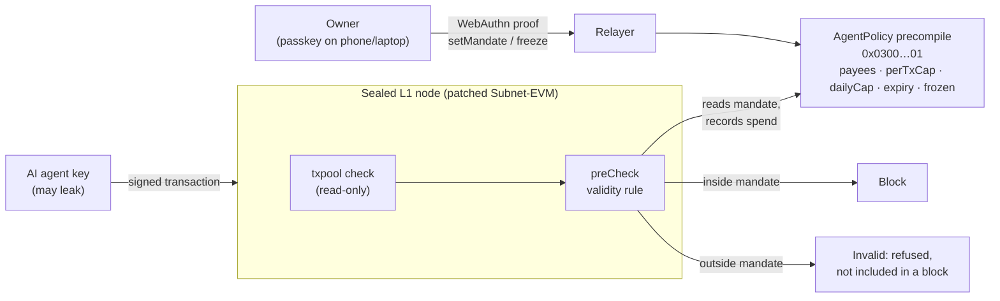

# Sealed Arena

[](https://github.com/NeitLN/Sealed-Arena/actions/workflows/ci.yml)
[](LICENSE)


**An Avalanche L1 where a payment from an AI agent's key is valid only if it stays inside the mandate its owner set with a passkey.**

Give the agent a card, not the whole wallet. If the agent is tricked, or its private key leaks, a transfer outside the mandate is not a reverted transaction: it is an **invalid** transaction: the chain's validator does not accept a block that contains it.

> **Today:** one validator, run by the team, on the Fuji testnet. The claim is about where the rule is checked (transaction validity), not about who operates the chain. See [Security model and limitations](#security-model-and-limitations).

> Built for Team1 Vietnam UniHack 2026, _Build on Avalanche_, track AI agents & security. Testnet only.

> **Tóm tắt (Tiếng Việt).** Sealed Arena là một Avalanche L1 riêng. Mỗi khoản chi từ khoá của một AI agent chỉ hợp lệ khi nằm trong uỷ quyền mà chủ ví đặt bằng passkey: danh sách người nhận, hạn mức mỗi giao dịch, hạn mức mỗi ngày, hạn dùng. Quy tắc nằm trong điều kiện hợp lệ của giao dịch ở node (Subnet-EVM), nên giao dịch vượt uỷ quyền không được đưa vào block mà validator của chain chấp nhận (hiện có một validator, do đội vận hành), kể cả khi kẻ tấn công cầm được private key của agent. Chủ ví có thể dừng agent bất cứ lúc nào bằng passkey. Dự án chỉ chạy trên testnet; tài sản không có giá trị quy đổi.

---

## The problem

AI agents now hold wallets and pay for APIs and data on their own (for example with x402). A prompt injection, a poisoned tool, or a leaked key can make the agent send money anywhere. Today's spending limits live in a server or in a smart-contract wallet. A contract wallet binds the funds held in it and the paths its code covers: the first wallet we wrote for comparison (O, caps only) let coins leave the mandate in 16 of 45 cases; with a payee list added (O+), in 0 of 45. Sealed Arena puts the check in transaction validity instead: one implementation in the node, for every registered agent, with fees counted in the caps.

## How it works



1. The owner registers an agent key with a P-256 **passkey** and sets a **mandate**: allowed payees (up to 16), a per-transaction cap, a daily cap and an expiry. Every change needs a fresh WebAuthn proof from that passkey, bound to the chain id, the agent and a nonce, so the agent key alone can never change it.
2. For every transaction **sent by a registered agent**, the node checks, in the transaction pool and again in `preCheck` (the step that decides whether a transaction can be part of a block):
   no contract creation · payee in the mandate · payee has no code · agent not frozen · `block.timestamp < expiry` · `value + gasLimit × gasFeeCap ≤ perTxCap` · `spentToday + charge ≤ dailyCap`.
3. A transaction that fails is rejected by the RPC and makes any block that contains it invalid. A transaction that passes is charged at its maximum cost before it executes, so the counter never falls below what actually left the account.

Transactions from other senders are not affected. Details and the exact contracts between components: [`docs/ARCHITECTURE.md`](docs/ARCHITECTURE.md) (Vietnamese).

## Why on-chain, why Avalanche, where the money comes from

- **Why a chain rule.** A contract wallet with caps and a payee list (our O+) also kept every coin inside the mandate in our 45 cases. What a validity rule changes is the kind of guarantee: the agent's own account holds the coins, so there is no wallet contract to go around; the rule is one implementation in the node for all agents; the maximum fee is counted in the caps; and a refused payment is not included in a block. The price is a separate L1 with, today, one validator run by the team. See [Why not a contract wallet?](#why-not-a-contract-wallet).
- **Why an Avalanche L1.** We need our own validity rule and still want to stay EVM-compatible and connected to existing assets. An Avalanche L1 runs our patched Subnet-EVM with its own validator set, keeps the C-Chain one message away (ICM), brings USDC across (ICTT), and costs a small continuous fee per validator rather than a network of our own to secure.
- **Where the money comes from.** The L1's native coin is Circle test USDC from the Fuji C-Chain, bridged with ICTT: it is locked in the home contract on the C-Chain and minted one-for-one on the L1. The other coins on the L1 are the genesis supply, which the ICTT remote counts as its initial reserve imbalance. The bridge is the only minter the project uses; the operator's admin key still holds the NativeMinter admin role (see the limits below). Testnet only.

## Business model (hypothesis)

We have no customers yet; this is a hypothesis we have not tested.

- **Who pays.** Agent platforms that hold wallets for their agents pay a fee per protected agent.
- **Fees on the L1.** Transaction fees on the Sealed L1 are a second source. The current genesis does not enable fee recipients, so collecting them would need a network upgrade.
- **How money moves.** Users deposit USDC from the C-Chain through ICTT (see [D6](docs/decisions/D6.md)); sellers withdraw to the C-Chain through the same bridge.

## Avalanche components used

| Component                                                            | Role here                                                                                                               |
| -------------------------------------------------------------------- | ----------------------------------------------------------------------------------------------------------------------- |
| Avalanche L1 on Fuji (ACP-77), one validator, P-Chain continuous fee | Runs the Sealed chain; created with the Avalanche Platform CLI                                                          |
| Subnet-EVM, patched (`chain/patches/`)                               | The validity rule in `preCheck` and the transaction pool                                                                |
| Stateful precompile `AgentPolicy` (`0x0300…01`)                      | Mandates, passkey (P-256 WebAuthn) proofs, spend counters                                                               |
| Precompiles TxAllowList, ContractDeployerAllowList, NativeMinter     | Who may send and deploy; the ICTT remote is the only minter the project uses (the admin key can also mint, see limit 2) |
| ValidatorManager on the Fuji C-Chain (proof of authority)            | The L1's validator set                                                                                                  |
| ICTT: `ERC20TokenHome` (C-Chain), `NativeTokenRemote` (L1)           | USDC as the L1's native coin                                                                                            |
| ICM (Teleporter) and the ICM relayer                                 | Carries the open challenge's survival record to the C-Chain                                                             |
| ERC-8004 registries on the Fuji C-Chain                              | Public identity and reputation record of the challenge agent                                                            |

**Size of the node change.** Two patch files (`0002-agentpolicy-precompile.patch`, `0003-agent-rule.patch`) on avalanchego `v1.15.3`: 1,912 non-blank lines of code added and 4 removed, plus 1,295 non-blank lines of tests. The rule itself is about 170 lines (`core/agent_rule.go` and its hooks in `core/state_transition.go` and `core/txpool/`); the rest is the `AgentPolicy` precompile, including WebAuthn verification and its ABI. An earlier spike patch (`0001-spike-agent-rule.patch`), cited in D1, was removed once the rule was written; D1's evidence can be re-run at commit `8d42e78`.

## Status

| Component                                                                                                                                    | Status |
| -------------------------------------------------------------------------------------------------------------------------------------------- | ------ |
| Local L1 from pinned avalanchego `v1.15.3` + Subnet-EVM, built and run in Docker (1–3 nodes)                                                 | Done   |
| `AgentPolicy` precompile: register, mandates, freeze/unfreeze with passkey (WebAuthn) proofs, spend counters                                 | Done   |
| Validity rule in `preCheck` and the txpool (all seven conditions, daily budget, concurrent payments)                                         | Done   |
| Genesis with allow-lists, 3-node network, leaked-key attack suite                                                                            | Done   |
| x402 payments with a signed native transaction: facilitator, sample seller, client                                                           | Done   |
| `ArenaRecorder`: funding, survival score, public breach check (`balance ≥ funded − charged`)                                                 | Done   |
| Buying agent driven by an LLM; prompt-injection scenarios with recorded transcripts and replay                                               | Done   |
| Owner console with passkeys (WebAuthn): link agent, set mandate, freeze/unfreeze; relayer; English/Vietnamese                                | Done   |
| Sealed L1 on Fuji: validator, public HTTPS RPC, USDC bridged to the native coin (ICTT), owner console on Vercel                              | Done   |
| Survival record sent over ICM (Teleporter) to the ERC-8004 reputation registry on the Fuji C-Chain                                           | Done   |
| Open red-team challenge: public agent key, RPC gateway that records every attempt, challenge and rules pages                                 | Done   |
| Comparison on Fuji with a plain wallet (P) and two minimal spending-limit contract wallets written by the team (O, and O+ with a payee list) | Done   |

Each design decision is recorded with its evidence (source lines, commands, results) in [`docs/decisions/`](docs/decisions):
[D1](docs/decisions/D1.md) a failing `preCheck` keeps a transaction out of every block ·
[D2](docs/decisions/D2.md) the rule stays in the node (tier 1) ·
[D3](docs/decisions/D3.md) how the local L1 is built ·
[D4](docs/decisions/D4.md) precompile address and P-256 support ·
[D5](docs/decisions/D5.md) x402 payment method `signed-native-tx` ·
[D6](docs/decisions/D6.md) USDC bridged with ICTT as the native coin ·
[D7](docs/decisions/D7.md) survival records in ERC-8004.

## Evaluation

Nine attack classes, 45 cases, on four groups with the same reference mandate (two sellers, 0.02 USDC per payment, 0.05 per day): **P** a plain wallet; **O** a minimal spending-limit contract wallet written by the team for this comparison, caps only; **O+** the same wallet with a payee list; **S** Sealed. O and O+ are not representative of audited wallet products. Full report with 95% Wilson intervals, every case and its limits: [`docs/EVALUATION.md`](docs/EVALUATION.md), generated from the raw results.

| Group                                            | Coins left outside the mandate (T0) | Unwanted payments inside the mandate (T1) | Benign purchases completed |
| ------------------------------------------------ | ----------------------------------- | ----------------------------------------- | -------------------------- |
| P plain wallet (Fuji C-Chain)                    | 36/45                               | 9/45                                      | 10/10                      |
| O limit wallet, caps only (Fuji C-Chain)         | 16/45                               | 16/45                                     | 10/10                      |
| O+ limit wallet with a payee list (Fuji C-Chain) | 0/45                                | 16/45                                     | 10/10                      |
| S Sealed (Sealed L1 on Fuji)                     | 0/45                                | 9/45                                      | 10/10                      |

O+ and S both kept every coin inside the mandate in these 45 cases. S ends with fewer T1 cases than O+ (9 against 16) only because it adds the maximum fee to each payment: in the 7 cases that differ, a payment of exactly the cap was refused with "budget exceeded". It does not judge what the owner wanted. The local three-node L1 gives the same result for S.

The leaked-key suite is reported separately, because it uses its own mandate: on the local L1 all 26 cases ended inside the mandate, and on the Sealed L1 on Fuji all 22 (see [`docs/EVALUATION.md`](docs/EVALUATION.md#leaked-key-suite)). The Fuji run has four cases fewer: Fuji has one node, so "sent straight to node 2" and "node 3" do not apply, and the blob (type 3) and set-code (type 4) cases were added after that run.

Three mandates are used, so the amounts differ between sections: the open challenge and the 20-payments-at-once run use 0.5 USDC per payment and 1 USDC per day; the 45-case evaluation uses 0.02 and 0.05; the leaked-key suite sets its own.

With two live models (claude-sonnet-5-5 and claude-haiku-5-5), the buying agent followed none of the injected pages in 30 runs (15 in the evaluation below, 15 in [`services/agent`](services/agent/README.md)). It followed a note planted in its memory in 5/5 runs when its owner's task told it to read its notes; the node (local Sealed L1) refused 15 of 15 payments to the attacker's address (agent-tier table in [`docs/EVALUATION.md`](docs/EVALUATION.md)). S does not stop T1: the rule limits where and how much, not what the owner wanted.

## Why not a contract wallet?

A contract wallet is the obvious alternative, and in our measurements a good one (O+) matches Sealed on T0. The two differ in what is guaranteed and what it costs.

|                         | O+: contract wallet with caps and a payee list (Fuji C-Chain)                                                                                                     | S: Sealed L1                                                                                            |
| ----------------------- | ----------------------------------------------------------------------------------------------------------------------------------------------------------------- | ------------------------------------------------------------------------------------------------------- |
| Where the money sits    | In the wallet contract; the agent key signs authorisations                                                                                                        | In the agent key's own account, as the L1's native coin                                                 |
| What the check covers   | Payments that go through the wallet's code (here EIP-3009 authorisations checked in `isValidSignature`). Anything the key holds outside the wallet is not covered | Every transaction sent from the agent's address on this L1. Off-chain signatures are not seen (limit 3) |
| Fees                    | Paid in AVAX by whoever submits the payment; outside the caps                                                                                                     | Paid by the agent in the same coin; the maximum fee is counted in both caps                             |
| A refused payment       | Fails the check before settlement, or reverts inside a block (with O, same settlement path: 18 of 20 reverted in our burst run)                                   | Refused by the node; not included in a block                                                            |
| T0 in our 45 cases      | 0/45                                                                                                                                                              | 0/45                                                                                                    |
| T1 in our 45 cases      | 16/45                                                                                                                                                             | 9/45, lower only because the maximum fee is added to each payment                                       |
| One rule for all agents | Each wallet is its own contract and can differ                                                                                                                    | One rule in the node; a registered agent cannot opt out                                                 |
| Who you trust           | The C-Chain's validators (many independent operators) and the wallet's code                                                                                       | The Sealed L1's validator (one today, run by the team), the patched node and the team's admin keys      |
| Payments                | x402 with EIP-3009, which sellers already accept                                                                                                                  | Our x402 method `signed-native-tx`; sellers add the network and our facilitator                         |
| Cost to adopt           | Deploy a wallet per agent                                                                                                                                         | Bridge USDC to a separate L1; the team must keep a Subnet-EVM fork up to date                           |

The burst run is `services/attacks/compare/results/fuji-2026-11-17T06-00-03-128Z.json` (the `/compare` page); the 45-case numbers are in [`docs/EVALUATION.md`](docs/EVALUATION.md).

**When O+ is the better choice.** Your agents pay in USDC on the C-Chain, your sellers use standard x402, and you want a chain run by many independent validators today.

**When Sealed is worth its price.** You want the limit to hold for the key itself, fees included, with no wallet code per agent, and you accept a separate L1. We have not yet shown that customers find this worth the price (see "Business model").

## Try it on Fuji (testnet)

- RPC: `https://sealed-arena.duckdns.org/rpc` (chain id `261126`, native coin: USDC bridged from Fuji with ICTT)
- Overview with live numbers: https://sealed-arena.vercel.app
- Owner console (passkey): https://sealed-arena.vercel.app/console. "Get a demo agent" gives a visitor a new agent on the Sealed L1, linked to their passkey before it may send, with 0.05 test USDC; then set a mandate and try a payment and a freeze
- Open red-team challenge: https://sealed-arena.vercel.app/arena (rules: [/arena/rules](https://sealed-arena.vercel.app/arena/rules))
- Comparison of P, O and S: https://sealed-arena.vercel.app/compare
- Who it is for and the business model (hypothesis): https://sealed-arena.vercel.app/business
- Every address and transaction: [`services/fuji-ops/deployments/fuji.json`](services/fuji-ops/deployments/fuji.json)

| What                                    | Where                       | Address or ID                                                                                             |
| --------------------------------------- | --------------------------- | --------------------------------------------------------------------------------------------------------- |
| Sealed L1                               | P-Chain subnet / blockchain | `xeBXaUqytA93ZuEKUm34LaYEy4UVqAGGrD6LCwNS8TWmCrJkG` / `UFo3xChM9b9efQkg93qPnswkJi7VR1XW7KQg9wE7gnCULfbYo` |
| Validator                               | L1                          | `NodeID-6TgSfU7azciZHPtkWZ6qnc8wsqMHyTTGL`                                                                |
| ValidatorManager                        | C-Chain                     | [`0x6911…6676`](https://testnet.snowtrace.io/address/0x69112c469092fed092d958d42a2c0f4fe16e6676)          |
| ICTT home (USDC)                        | C-Chain                     | [`0x9806…6d2d`](https://testnet.snowtrace.io/address/0x980619791b89410b03ce02a479b032bddfe46d2d)          |
| ICTT remote (native coin)               | L1                          | `0x0fb5053b11fefc69ac31e3e87f60ce8677f6483e`                                                              |
| ArenaRecorder                           | L1                          | `0x60d046fa32a101229f78d69b655a91193cdf4f77`                                                              |
| ReputationReceiver (ERC-8004 writer)    | C-Chain                     | [`0x3c99…6fda`](https://testnet.snowtrace.io/address/0x3c99b37bf7279220ae2f09f12bbdc0742b056fda)          |
| ERC-8004 Reputation registry, agent 303 | C-Chain                     | [`0x8004…8713`](https://testnet.snowtrace.io/address/0x8004B663056A597Dffe9eCcC1965A193B7388713)          |

The L1 has no public block explorer; read it through the RPC above. The operator runs the only validator. See "Security model and limitations" below.

## Quick start

Requirements: Docker (running), Node.js 24, pnpm 11, Git, and bash (Git Bash on Windows). Go and Foundry are not needed on the host; they run in pinned containers.

After `git clone --recursive` and `pnpm install`, three commands build the node, start a local L1 and run the leaked-key attack suite:

```bash
bash chain/scripts/fetch.sh && bash chain/scripts/build.sh
bash scripts/localnet.sh up && bash scripts/localnet.sh seed
pnpm --filter attacks leaked-key
```

Step by step, with the other suites:

```bash
git clone --recursive https://github.com/NeitLN/Sealed-Arena.git
cd Sealed-Arena
pnpm install

bash scripts/check.sh            # typecheck, lint, TS tests, Foundry, Go tests of the node patches

bash chain/scripts/fetch.sh      # avalanchego v1.15.3 at the pinned commit, patches applied
bash chain/scripts/build.sh      # node image sealed-node:dev
bash scripts/localnet.sh up      # local Sealed L1 with three validators
bash scripts/localnet.sh seed    # test agent with a sample mandate
bash chain/scripts/smoke.sh      # chain id 261126 and a test transfer
bash chain/tests/rule/run.sh     # mandate, rejected payments, freeze, concurrent payments
pnpm --filter attacks leaked-key # someone holding the agent's key tries every way out
pnpm --filter attacks x402       # x402 purchase end to end, and the payments it must refuse
bash scripts/localnet.sh down    # stop and delete the local network
```

More, including logs and troubleshooting: [`docs/RUNBOOK.md`](docs/RUNBOOK.md).

## Repository layout

| Path                                  | Contents                                                                                                                              |
| ------------------------------------- | ------------------------------------------------------------------------------------------------------------------------------------- |
| [`chain/`](chain)                     | Patches on avalanchego (`patches/`), pinned upstream, node Dockerfile, local network launcher, Go-side tests and network test scripts |
| [`contracts/`](contracts)             | Solidity (Foundry, run in Docker)                                                                                                     |
| [`packages/shared/`](packages/shared) | Chain id, addresses, ABI, and the encoders for passkey challenges and proofs, shared by every service                                 |
| `services/`, `web/`                   | x402 facilitator, demo seller, buying agent, relayer, RPC gateway, Fuji operations, attack suites, web app                            |
| [`scripts/`](scripts)                 | `check.sh`, `check-localnet.sh`, `localnet.sh`, `forge.sh`, `submission-check.sh`                                                     |
| [`docs/`](docs)                       | Architecture, runbook, decision records, evaluation, submission checklist                                                             |

Only our changes to avalanchego live in this repository, as patch files applied to a pinned tag, so reviewers can read exactly what we wrote.

## Testing

`bash scripts/check.sh` is the single quick check and runs in CI on every pull request. Highlights:

- Go tests run against hand-built blocks: a block that contains a forbidden agent transaction must be rejected at import, for transaction types 0, 1 and 2; a blob transaction (type 3) from an agent is refused too, and no other type can be decoded at the pinned version (limit 14).
- A Go test pins the daily window to the UTC day: a payment in the last second of a day and one in the first second of the next are both valid, and a third on that day is refused.
- A VM-level test drives the real transaction pool and block builder: 20 payments that are each valid alone are queued at once, and only what fits the daily budget reaches a block.
- WebAuthn test vectors in [`chain/testvectors/`](chain/testvectors) are shared by the Go precompile tests and the TypeScript encoder tests, so both sides agree byte for byte.
- `chain/tests/rule/run.sh` checks the same behaviour over RPC on a running local L1 with one and three nodes.
- `chain/tests/byzantine/run.sh` starts the local L1 with node 3 running a Subnet-EVM build without the agent rule (the precompile only). Node 3 takes a payment from the agent to a stranger into its pool and proposes blocks with it; nodes 1 and 2 reject each of those blocks (`block verification failed … agent: payee not allowed`), the chain keeps going, the three nodes agree on it, and the payment never enters it. This is a local network: three validators in one container, all run by the team. The result and the node log lines are in [`chain/tests/byzantine/results/`](chain/tests/byzantine/results).
- The x402 suite (`services/attacks/src/x402.ts`) starts the facilitator and two sample sellers, buys one dataset end to end, then sends each payment that must be refused (wrong payee, price, resource, chain id, signer, reused request id, already broadcast, seller outside the mandate) and checks the agent's balance and nonce do not move.
- `ArenaRecorder` has Foundry tests for the score, the invariant, breaches and direct deposits (with a fuzz test), and `services/attacks/src/arena.ts` runs the leaked-key suite against an agent funded only through the recorder, then checks that a checkpoint finds no breach.
- `web/e2e/owner.e2e.ts` drives the owner console in Chromium with a virtual passkey on the local network: link an agent, set a mandate, freeze and unfreeze (the agent's payment is refused while frozen), and checks that a different passkey cannot freeze the agent.
- The [leaked-key attack suite](services/attacks) plays someone who holds the agent's key: 26 ways out (transaction types 0, 1 and 2, a blob and a set-code transaction to an allowed payee, fees, contracts, the precompiles, replay, each node directly, frozen, expired, budget, 20 at once), one positive control, then the balance invariant and agreement of the three nodes. `bash scripts/check-localnet.sh` runs it with the rest of the network checks.

## Security model and limitations

What the rule gives: on the Sealed L1, a transaction sent with an agent's key that falls outside the agent's mandate cannot be included in a block. The patched node checks this as part of block validity; today one validator, run by the team, does so.

What it does not give, stated plainly:

1. **Testnet only.** Coins on the L1 have no monetary value. This is not a payment service.
2. **One validator, run by the team.** The claim is that the rule is part of block validity on this chain, not that control is spread across independent parties: today the team operates the validator, holds the admin keys (TxAllowList, ContractDeployerAllowList, NativeMinter, and the manager key of limit 13) and can ship network upgrades. The node source and the validator set are public. Network upgrades and genesis are operator actions outside the rule; we commit to shipping no upgrade that touches agent addresses. Disabling and re-enabling the `AgentPolicy` precompile in a network upgrade would erase every registration and mandate; the same commitment covers this. The operator's admin key also holds the NativeMinter admin role on the L1 and could mint native coin outside the bridge; the project uses the bridge as its only minter.
3. **Only the native coin on this L1 is covered.** The rule sees transactions, not off-chain signatures (permits, EIP-3009 authorisations). The L1 has no token that honours such signatures, and contract deployment is allow-listed. Assets on other chains are not covered.
4. **A leaked key can still spend inside the mandate**: to allowed payees, up to the daily budget, until the owner freezes the agent or the mandate expires. The daily budget is counted per UTC day (it resets at 00:00 UTC, 07:00 in Vietnam), not over a rolling 24 hours: around 00:00 UTC up to twice the daily cap can be spent within minutes.
5. **Someone holding the key can grief**: use up the daily budget or occupy nonces.
6. **Simulation is not admission.** `eth_call` and `eth_estimateGas` do not apply the rule; services read the mandate from the precompile instead.
7. **The open challenge measures how hard the system was tried, not that it is safe.**
8. **The ERC-8004 record is only as trustworthy as its writer.** Anyone can give feedback in ERC-8004; read the survival record as feedback whose client is our ReputationReceiver (address in `services/fuji-ops/deployments/fuji.json`). ICM only carries this record; it plays no part in keeping funds safe, which is the L1 node's rule.
9. **x402 here needs our payment method.** Sellers must add the network `eip155:261126` and point `/verify` and `/settle` at this facilitator; a standard x402 client (EIP-3009 tokens) cannot pay it. The facilitator holds no keys, but a seller still has to trust it or read the chain itself (the sample seller does both).
10. **Owner passkey proofs are bound to the chain id and the agent, not to one deployment.** The challenge covers the chain id (`261126`), the agent and a nonce. The local network and the L1 on Fuji share that chain id, so each deployment must register its agents under its own owner key; the Fuji challenge agent does. Binding proofs to the blockchain ID is planned.
11. **The precompile checks less of WebAuthn than a full relying party.** It verifies the P-256 signature, the challenge and the User Present flag. It does not check `rpIdHash` or the origin, and it does not require User Verification (the owner console asks for it as `preferred`). The proof also does not show the owner what is being signed: the passkey prompt names the site, not the mandate. If the console's origin is compromised (its hosting, its domain, or a script it loads), the owner can be made to sign a different mandate.
12. **Waiting payments on the Fuji node until its next update.** The node in this repository counts an agent's pooled payments toward its daily budget and refuses the ones that do not fit; when a new block makes pooled payments invalid (a freeze, a lower cap, a removed payee, an expired mandate), it drops them. The node on Fuji still runs the earlier build, where payments the pool accepted but the block builder left out (over the day's budget) stay in the pool and can enter a block on a later day, within that day's cap. In both, a payment signed today can enter a block on another day if it is still pending then: an Ethereum transaction has no expiry.
13. **The relayer host can allow senders.** For demo agents the relayer holds a second key with the TxAllowList manager role. It registers each demo agent to the visitor's passkey before allowing it, but whoever takes over the host could allow any address to send, outside any mandate. The admin can remove the role (`setNone`).
14. **The block-level check filters transaction types more loosely than the pool.** The pool accepts only types 0, 1 and 2 from an agent. The block-validity check (`preCheck`) refuses a transaction that carries blob hashes and does not otherwise look at the type. At the pinned node version no type above 3 can be decoded, and tests cover a blob transaction in a hand-built block and types 3 and 4 over RPC. Before a network upgrade enables a new transaction type (for example set-code), the block-level check must be tightened.

Found a problem? See [SECURITY.md](SECURITY.md).

## Legal note

Sealed Arena runs on Avalanche's Fuji testnet. Its coins and test USDC have no monetary value, and it is not a payment or custody service. The open red-team challenge is an authorised bug-hunting program within the scope set on its rules page (the Sealed L1 on Fuji and this project's contracts and services only); attacks on anything else, including Avalanche's networks, other teams and infrastructure providers, and denial of service, are not authorised.

**Vietnam.** Vietnam's Law on Digital Technology Industry No. 71/2025/QH15 (in force from 1 January 2026) defines digital assets and crypto assets in Articles 46–47. Government Resolution No. 05/2025/NQ-CP (in force from 9 September 2025, a five-year pilot) allows crypto-asset services only from organisations licensed by the Ministry of Finance. Decree No. 52/2024/NĐ-CP on non-cash payments prohibits issuing, providing or using unlawful means of payment (Article 3(11), Article 8(6)), and the State Bank of Vietnam has stated that bitcoin and similar virtual currencies are not a lawful means of payment in Vietnam. This project does not issue, offer or trade crypto assets, provides no payment or crypto-asset service, and holds no one's funds; every token in it is a testnet token that cannot be redeemed for money. This note is not legal advice.

## License

[MIT](LICENSE) for this project's code. The patches in [`chain/patches/`](chain/patches) modify [avalanchego](https://github.com/ava-labs/avalanchego) and follow its BSD 3-Clause license.

Built on [avalanchego](https://github.com/ava-labs/avalanchego) and Subnet-EVM (Ava Labs), [Foundry](https://github.com/foundry-rs/foundry), and [viem](https://github.com/wevm/viem).
