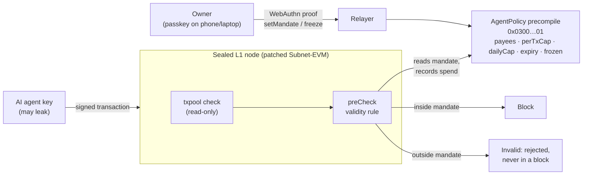

# Sealed Arena

[](https://github.com/NeitLN/Sealed-Arena/actions/workflows/ci.yml)
[](LICENSE)


**An Avalanche L1 where a payment from an AI agent's key is valid only if it stays inside the mandate its owner set with a passkey.**

Give the agent a card, not the whole wallet. If the agent is tricked, or its private key leaks, a transfer outside the mandate is not a reverted transaction: it is an **invalid** transaction that no block accepted by the chain's validators can contain.

> Built for Team1 Vietnam UniHack 2026, _Build on Avalanche_, track AI agents & security. Testnet only.

> **Tóm tắt (Tiếng Việt).** Sealed Arena là một Avalanche L1 riêng. Mỗi khoản chi từ khoá của một AI agent chỉ hợp lệ khi nằm trong uỷ quyền mà chủ ví đặt bằng passkey: danh sách người nhận, hạn mức mỗi giao dịch, hạn mức mỗi ngày, hạn dùng. Quy tắc nằm trong điều kiện hợp lệ của giao dịch ở node (Subnet-EVM), nên giao dịch vượt uỷ quyền không vào được block nào, kể cả khi kẻ tấn công cầm được private key của agent. Chủ ví có thể dừng agent bất cứ lúc nào bằng passkey. Dự án chỉ chạy trên testnet; tài sản không có giá trị quy đổi.

---

## The problem

AI agents now hold wallets and pay for APIs and data on their own (for example with x402). A prompt injection, a poisoned tool, or a leaked key can make the agent send money anywhere. Today's spending limits live in a server or in a smart-contract wallet that the agent calls, so whoever controls the agent's key can often reach around them.

## How it works



1. The owner registers an agent key with a P-256 **passkey** and sets a **mandate**: allowed payees (up to 16), a per-transaction cap, a daily cap and an expiry. Every change needs a fresh WebAuthn proof from that passkey, bound to the chain id, the agent and a nonce, so the agent key alone can never change it.
2. For every transaction **sent by a registered agent**, the node checks, in the transaction pool and again in `preCheck` (the step that decides whether a transaction can be part of a block):
   no contract creation · payee in the mandate · payee has no code · agent not frozen · `block.timestamp < expiry` · `value + gasLimit × gasFeeCap ≤ perTxCap` · `spentToday + charge ≤ dailyCap`.
3. A transaction that fails is rejected by the RPC and makes any block that contains it invalid. A transaction that passes is charged at its maximum cost before it executes, so the counter never falls below what actually left the account.

Transactions from other senders are not affected. Details and the exact contracts between components: [`docs/ARCHITECTURE.md`](docs/ARCHITECTURE.md) (Vietnamese).

## Status

| Component                                                                                                       | Status  |
| --------------------------------------------------------------------------------------------------------------- | ------- |
| Local L1 from pinned avalanchego `v1.15.3` + Subnet-EVM, built and run in Docker (1–3 nodes)                    | Done    |
| `AgentPolicy` precompile: register, mandates, freeze/unfreeze with passkey (WebAuthn) proofs, spend counters    | Done    |
| Validity rule in `preCheck` and the txpool (all seven conditions, daily budget, concurrent payments)            | Done    |
| Genesis with allow-lists, 3-node network, leaked-key attack suite                                               | Done    |
| x402 payments with a signed native transaction: facilitator, sample seller, client                              | Done    |
| `ArenaRecorder`: funding, survival score, public breach check (`balance ≥ funded − charged`)                    | Done    |
| Buying agent driven by an LLM                                                                                   | Planned |
| Owner console with passkeys (WebAuthn): link agent, set mandate, freeze/unfreeze; relayer; English/Vietnamese   | Done    |
| Sealed L1 on Fuji: validator, public HTTPS RPC, USDC bridged to the native coin (ICTT), owner console on Vercel | Done    |
| Survival record sent over ICM (Teleporter) to the ERC-8004 reputation registry on the Fuji C-Chain              | Done    |
| Open red-team challenge: public agent key, RPC gateway that records every attempt, challenge and rules pages    | Done    |

Each design decision is recorded with its evidence (source lines, commands, results) in [`docs/decisions/`](docs/decisions):
[D1](docs/decisions/D1.md) a failing `preCheck` keeps a transaction out of every block ·
[D3](docs/decisions/D3.md) how the local L1 is built ·
[D4](docs/decisions/D4.md) precompile address and P-256 support ·
[D5](docs/decisions/D5.md) x402 payment method `signed-native-tx`.

## Try it on Fuji (testnet)

- RPC: `https://sealed-arena.duckdns.org/rpc` (chain id `261126`, native coin: USDC bridged from Fuji with ICTT)
- Owner console: https://sealed-arena.vercel.app
- Open red-team challenge: https://sealed-arena.vercel.app/arena (rules: [/arena/rules](https://sealed-arena.vercel.app/arena/rules))
- Addresses and transactions: [`services/fuji-ops/deployments/fuji.json`](services/fuji-ops/deployments/fuji.json)

The operator runs the only validator. See "Security model and limitations" below.

## Quick start

Requirements: Docker (running), Node.js 24, pnpm 11, Git, and bash (Git Bash on Windows). Go and Foundry are not needed on the host; they run in pinned containers.

```bash
git clone --recursive https://github.com/NeitLN/Sealed-Arena.git
cd Sealed-Arena
pnpm install

bash scripts/check.sh            # typecheck, lint, TS tests, Foundry, Go tests of the node patches

bash chain/scripts/fetch.sh      # avalanchego v1.15.3 at the pinned commit, patches applied
bash chain/scripts/build.sh      # node image sealed-node:dev
bash scripts/localnet.sh up      # local Sealed L1 with three validators
bash scripts/localnet.sh seed    # test agent with a sample mandate
bash chain/scripts/smoke.sh      # chain id 261126 and a test transfer
bash chain/tests/rule/run.sh     # mandate, rejected payments, freeze, concurrent payments
pnpm --filter attacks leaked-key # someone holding the agent's key tries every way out
pnpm --filter attacks x402       # x402 purchase end to end, and the payments it must refuse
bash scripts/localnet.sh down    # stop and delete the local network
```

More, including logs and troubleshooting: [`docs/RUNBOOK.md`](docs/RUNBOOK.md).

## Repository layout

| Path                                  | Contents                                                                                                                              |
| ------------------------------------- | ------------------------------------------------------------------------------------------------------------------------------------- |
| [`chain/`](chain)                     | Patches on avalanchego (`patches/`), pinned upstream, node Dockerfile, local network launcher, Go-side tests and network test scripts |
| [`contracts/`](contracts)             | Solidity (Foundry, run in Docker)                                                                                                     |
| [`packages/shared/`](packages/shared) | Chain id, addresses, ABI, and the encoders for passkey challenges and proofs, shared by every service                                 |
| `services/`, `web/`, `infra/`         | x402 facilitator, demo seller, buying agent, RPC gateway, web app, deployment (in progress)                                           |
| [`scripts/`](scripts)                 | `check.sh`, `localnet.sh`, `forge.sh`                                                                                                 |
| [`docs/`](docs)                       | Architecture, runbook, decision records                                                                                               |

Only our changes to avalanchego live in this repository, as patch files applied to a pinned tag, so reviewers can read exactly what we wrote.

## Testing

`bash scripts/check.sh` is the single quick check and runs in CI on every pull request. Highlights:

- Go tests run against hand-built blocks: a block that contains a forbidden agent transaction must be rejected at import, for every transaction type.
- A VM-level test drives the real transaction pool and block builder: 20 payments that are each valid alone are queued at once, and only what fits the daily budget reaches a block.
- WebAuthn test vectors in [`chain/testvectors/`](chain/testvectors) are shared by the Go precompile tests and the TypeScript encoder tests, so both sides agree byte for byte.
- `chain/tests/rule/run.sh` checks the same behaviour over RPC on a running local L1 with one and three nodes.
- The x402 suite (`services/attacks/src/x402.ts`) starts the facilitator and two sample sellers, buys one dataset end to end, then sends each payment that must be refused (wrong payee, price, resource, chain id, signer, reused request id, already broadcast, seller outside the mandate) and checks the agent's balance and nonce do not move.
- `ArenaRecorder` has Foundry tests for the score, the invariant, breaches and direct deposits (with a fuzz test), and `services/attacks/src/arena.ts` runs the leaked-key suite against an agent funded only through the recorder, then checks that a checkpoint finds no breach.
- `web/e2e/owner.e2e.ts` drives the owner console in Chromium with a virtual passkey on the local network: link an agent, set a mandate, freeze and unfreeze (the agent's payment is refused while frozen), and checks that a different passkey cannot freeze the agent.
- The [leaked-key attack suite](services/attacks) plays someone who holds the agent's key: 24 ways out (every transaction type, fees, contracts, the precompiles, replay, each node directly, frozen, expired, budget, 20 at once), one positive control, then the balance invariant and agreement of the three nodes. `bash scripts/check-localnet.sh` runs it with the rest of the network checks.

## Security model and limitations

What the rule gives: on the Sealed L1, a transaction sent with an agent's key that falls outside the agent's mandate cannot be included in a block. This is enforced by the chain's validators running the patched node.

What it does not give, stated plainly:

1. **Testnet only.** Coins on the L1 have no monetary value. This is not a payment service.
2. **The team runs all validators.** The claim is "the rule is enforced by the chain's consensus", not decentralisation. The node source and the validator set are public. Network upgrades and genesis are operator actions outside the rule; we commit to shipping no upgrade that touches agent addresses.
3. **Only assets on this L1 are protected.**
4. **A leaked key can still spend inside the mandate**: to allowed payees, up to the daily budget, until the owner freezes the agent or the mandate expires.
5. **Someone holding the key can grief**: use up the daily budget or occupy nonces.
6. **Simulation is not admission.** `eth_call` and `eth_estimateGas` do not apply the rule; services read the mandate from the precompile instead.
7. **The open challenge measures how hard the system was tried, not that it is safe.**
8. **The ERC-8004 record is only as trustworthy as its writer.** Anyone can give feedback in ERC-8004; read the survival record as feedback whose client is our ReputationReceiver (address in `services/fuji-ops/deployments/fuji.json`). ICM only carries this record; it plays no part in keeping funds safe, which is the L1 node's rule.
9. **x402 here needs our payment method.** Sellers must add the network `eip155:261126` and point `/verify` and `/settle` at this facilitator; a standard x402 client (EIP-3009 tokens) cannot pay it. The facilitator holds no keys, but a seller still has to trust it or read the chain itself (the sample seller does both).

Found a problem? See [SECURITY.md](SECURITY.md).

## License

[MIT](LICENSE) for this project's code. The patches in [`chain/patches/`](chain/patches) modify [avalanchego](https://github.com/ava-labs/avalanchego) and follow its BSD 3-Clause license.

Built on [avalanchego](https://github.com/ava-labs/avalanchego) and Subnet-EVM (Ava Labs), [Foundry](https://github.com/foundry-rs/foundry), and [viem](https://github.com/wevm/viem).
